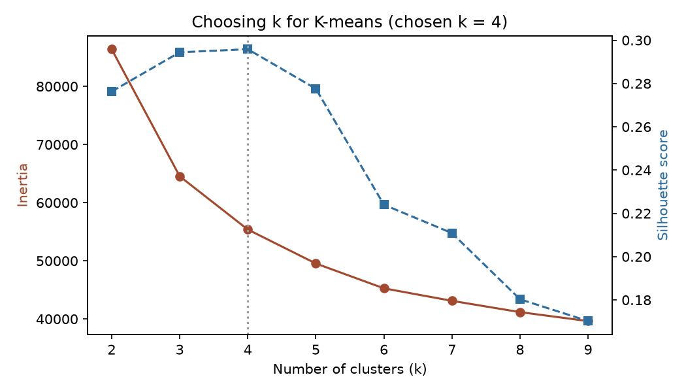
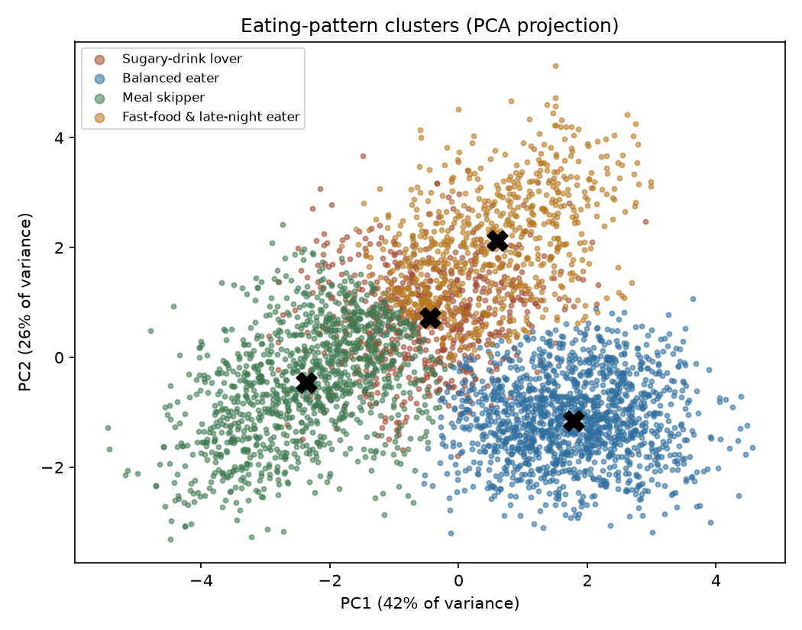
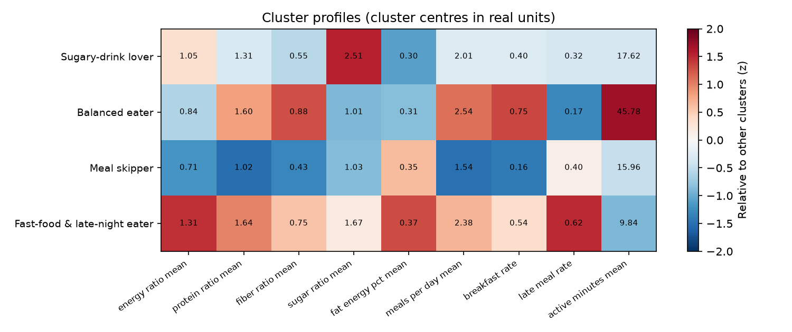
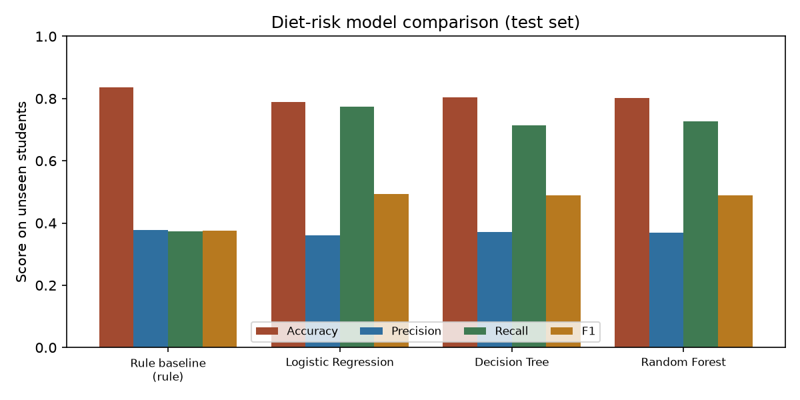
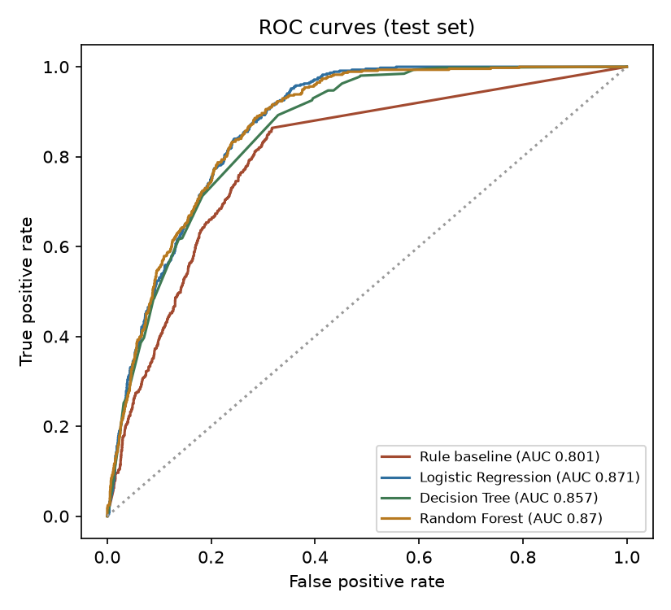
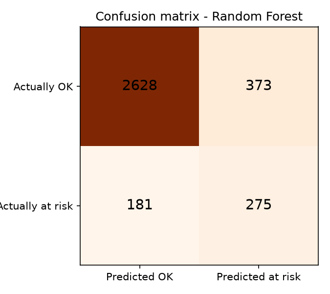
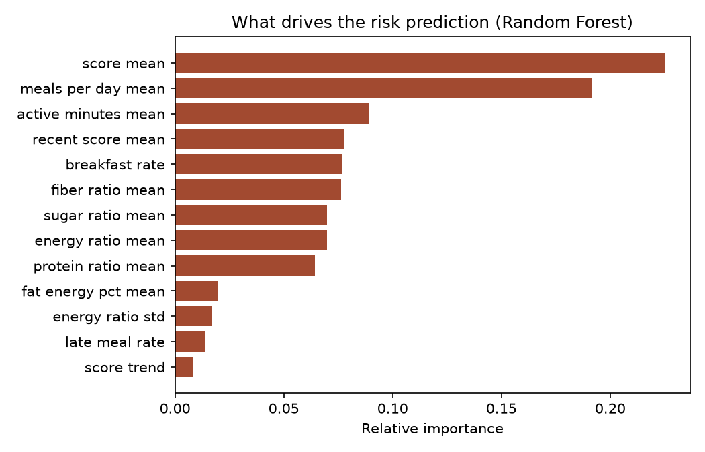

# Diet monitoring models: training report

_Generated 13 November 2026 13:14 by `ml/train.py`._

## 1. Data

- 300 simulated students over 60 days (18,000 student-days, 15,528 with food logged).
- 13,753 weekly windows (7 days of history + the following 3 days).
- 14.3% of windows are labelled **at risk** (average diet score below 55 over the next 7 days).
- Days without any food logged are treated as *not logged*, not as *ate nothing*.
- The data is simulated (see `ml/simulate.py`) because the app does not yet have months of real diaries. The same pipeline retrains on real diaries once they exist.

### Features (computed from the last 7 logged days)

| Feature | Meaning |
| --- | --- |
| energy_ratio_mean / std | Calories eaten / personal energy target (Mifflin-St Jeor x activity factor), average and day-to-day spread |
| protein_ratio_mean | Protein / target (0.8 g per kg body weight) |
| fiber_ratio_mean | Fibre / 25 g (WHO) |
| sugar_ratio_mean | Sugar / limit (10% of energy, WHO) |
| fat_energy_pct_mean | Share of energy from fat (aim under 35%) |
| meals_per_day_mean, breakfast_rate, late_meal_rate | Meal regularity |
| active_minutes_mean | Activity check-ins (aim for 30 minutes a day) |
| score_mean, score_trend | Average daily diet score (0-100) and its slope over the week |

## 2. Model A: eating-pattern clustering (K-means)

- Features: energy_ratio_mean, protein_ratio_mean, fiber_ratio_mean, sugar_ratio_mean, fat_energy_pct_mean, meals_per_day_mean, breakfast_rate, late_meal_rate, active_minutes_mean (standardised).
- k searched from 2 to 9; **k = 4** has the best silhouette score (**0.296**) in the 4-8 range.
- Adjusted Rand Index against the simulator's hidden habits: **0.509** (1 = perfect match, 0 = random). The models never see these hidden labels; this checks the clusters recover real habits.

| k | Inertia | Silhouette |
| --- | --- | --- |
| 2 | 86394 | 0.276 |
| 3 | 64535 | 0.294 |
| 4 | 55387 | 0.296 |
| 5 | 49539 | 0.278 |
| 6 | 45270 | 0.224 |
| 7 | 43118 | 0.211 |
| 8 | 41177 | 0.180 |
| 9 | 39638 | 0.170 |

| Cluster | Windows | Description |
| --- | --- | --- |
| Sugary-drink lover | 2,250 | Much of the day's sugar comes from soft drinks, juices and snacks. |
| Balanced eater | 4,846 | Regular meals with a good mix of energy, protein and fibre. |
| Meal skipper | 3,938 | Breakfast and lunch are often missed, so the body runs short of energy and protein. |
| Fast-food & late-night eater | 2,719 | Fried foods such as chips and burgers make up many meals, portions are large and eating often happens late at night. |

Clusters vs hidden habits (number of windows):

| | active | balanced | fast_food | meal_skipper | overeater | sugar_drinker |
| --- | --- | --- | --- | --- | --- | --- |
| Balanced eater | 1477 | 3290 | 16 | 1 | 21 | 41 |
| Fast-food & late-night eater | 35 | 72 | 692 | 7 | 1781 | 132 |
| Meal skipper | 21 | 144 | 1607 | 1937 | 58 | 171 |
| Sugary-drink lover | 8 | 49 | 366 | 26 | 28 | 1773 |

## 3. Model B: diet-risk prediction

Question: *given the last 7 days, will this student's diet score average below 55 over the next 7 days?*

- Students are split 75% / 25% so the test set contains **only students the models never saw**.
- Models are compared with 5-fold cross-validation grouped by student on the training students.

| Model | CV F1 | CV ROC AUC | Test accuracy | Test precision | Test recall | Test F1 | Test ROC AUC |
| --- | --- | --- | --- | --- | --- | --- | --- |
| Rule baseline (last week score < 55) | 0.410 ± 0.059 | 0.766 | 0.836 | 0.377 | 0.373 | 0.375 | 0.801 |
| Logistic Regression | 0.441 ± 0.046 | 0.819 | 0.790 | 0.361 | 0.774 | 0.493 | 0.871 |
| Decision Tree | 0.416 ± 0.047 | 0.796 | 0.803 | 0.371 | 0.713 | 0.488 | 0.857 |
| Random Forest | 0.451 ± 0.041 | 0.822 | 0.801 | 0.370 | 0.726 | 0.490 | 0.870 |

**Chosen model: Random Forest** (highest cross-validated F1). It is exported to `ml/models/diet_models.json` and runs inside the Node server.

The alarm threshold was tuned on the training students' out-of-fold predictions: **0.58**. At that threshold the test students give accuracy 0.840, precision 0.424, recall 0.603, F1 0.498 and ROC AUC 0.870.

Confusion matrix on the test students: 275 at-risk windows caught, 181 missed, 373 false alarms, 2628 correctly OK.

## 4. Model C: recommendations

Recommendations are scored live in `diet-model.js`: how well a menu item fills the gap between today's intake and the student's targets (energy, protein, fibre, fat, sugar), plus a per-student logistic regression trained on their helpful / not helpful ratings, plus how often students in the same eating-pattern cluster buy the item.

## 5. Limitations

- Nutrition values are estimates from standard food composition tables, not lab analysis of THE KITCHEN's meals.
- The models are trained on simulated diaries; accuracy on real students must be re-measured after retraining.
- The system gives general guidance and is not a medical diagnosis.
